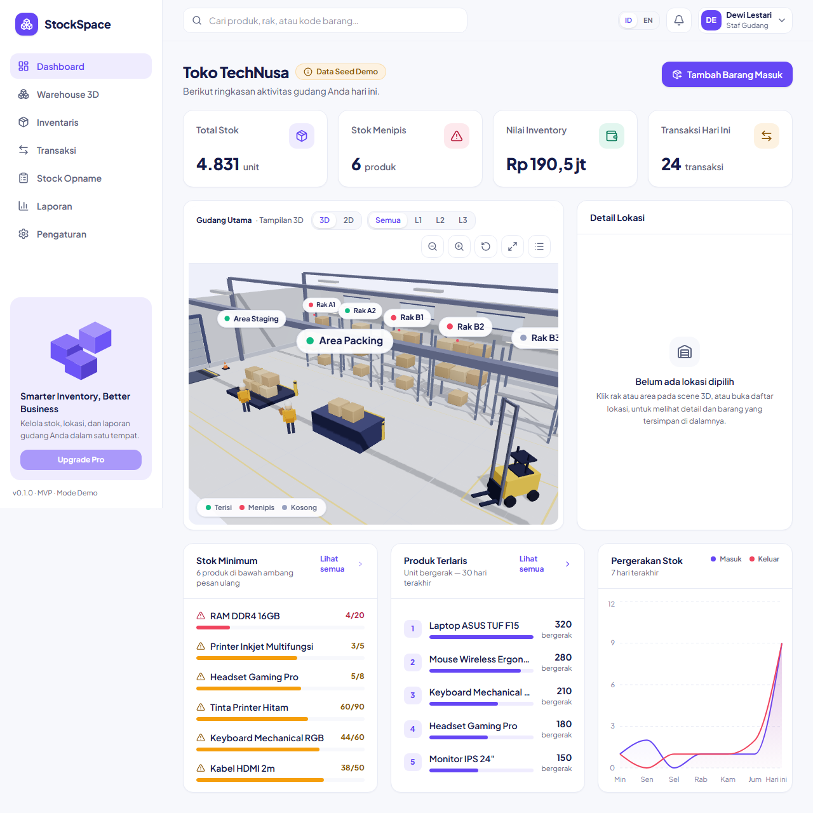
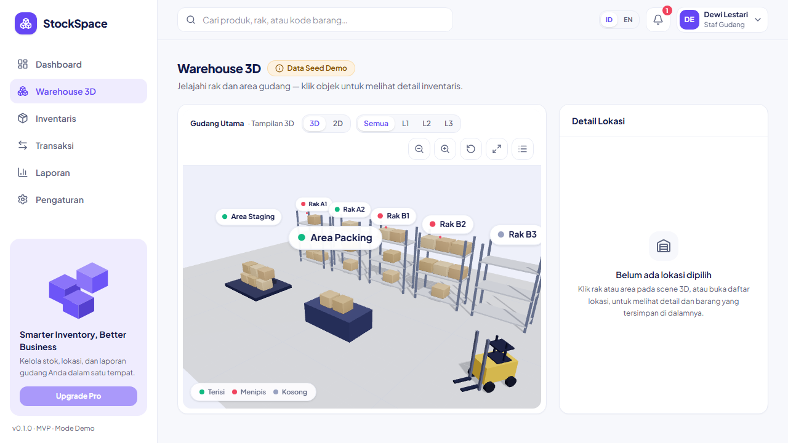
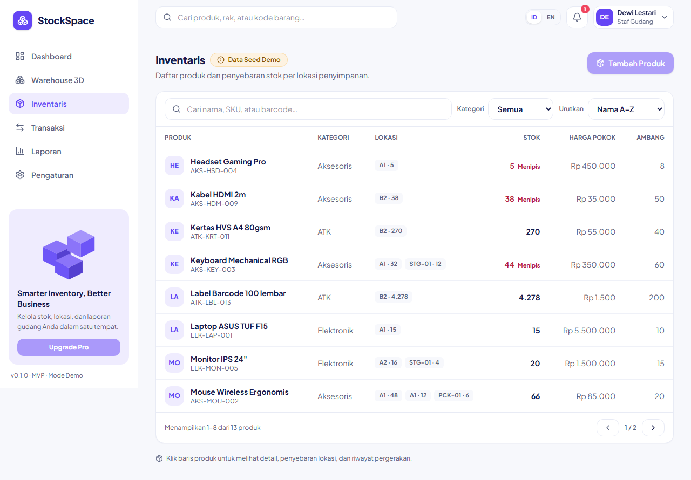
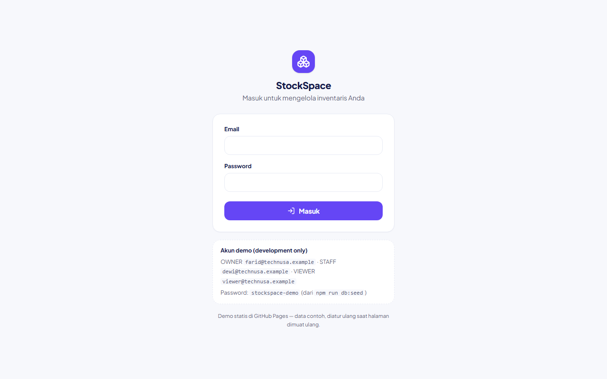

# StockSpace

**Open-source inventory management with an interactive 3D warehouse.**

StockSpace helps small businesses manage inventory while seeing exactly where
products are stored — receive, move, adjust, and issue stock, and explore your
racks in a real 3D scene driven by your saved warehouse layout. Available in
**Bahasa Indonesia and English**.

[](https://github.com/zann06/StockSpace/actions)
[](https://zann06.github.io/StockSpace/)
[License: MIT](LICENSE)

**Try it now — no install:** [interactive live demo](https://zann06.github.io/StockSpace/)
(static build on GitHub Pages: sign in with the demo accounts below, record
movements, watch the 3D delivery animation — sample data, resets on refresh).

## Demo

End-to-end flow recorded against the real stack (API + PostgreSQL + browser) —
sign in, browse the 3D warehouse, record a stock-in, watch the delivery box fly
to its rack, and see the dashboard update:


## Screenshots

| | |
| --- | --- |
|  |  |
|  |  |

*Captured by the Playwright smoke test against the live stack; the UI is built
as real React components following `design-reference.png`.*

## Features

- **Interactive 3D warehouse** — procedural racks, shelves, cargo boxes,
  staging/packing areas. Click a rack to open its items and movement history;
  orbit/pan/zoom, camera reset, 3D/2D top-down toggle, level filters (L1–L3),
  fullscreen, and an accessible location list when WebGL is unavailable.
  A committed stock movement triggers a short **delivery animation** (a cargo
  box flies to the destination rack) — skipped under reduced-motion.
- **Real inventory workflows** — stock in/out/transfer/adjustment forms write
  to PostgreSQL inside database transactions; overselling is impossible by
  construction and covered by integration tests, including concurrent requests.
- **Dashboard & reports from live data** — KPIs, low-stock summary, top-moved
  products, 7-day movement chart, per-location utilization, filtered movement
  report, and CSV export.
- **Authentication & roles** — email/password sign-in with cookie sessions
  (better-auth). Roles enforced server-side: VIEWER read-only, STAFF records
  movements, ADMIN+ edits products. Workspaces are membership-scoped.
- **Low-stock notifications** — created automatically when a product crosses
  its reorder threshold, grouped (one unread alert per product).
- **Onboarding tour** — an animated spotlight tour introduces the app on first
  sign-in; replay it anytime from Settings.
- **Bilingual (ID/EN)** — switch language from the header or profile menu;
  dates and number formats follow the active locale.
- **Rate limiting, a11y, and E2E** — auth 20/min, movements 60/min, global
  300/min; axe accessibility scan in CI; Playwright smoke test boots the real
  API + web + database.
- **Responsive & accessible** — off-canvas navigation on mobile, keyboard
  support throughout, visible focus states, WCAG-AA text contrast, and
  reduced-motion respected.

Demo data is a fictional seeded workspace ("Toko TechNusa") and every page
labels it with a visible badge.

## Tech stack

| Layer    | Choice                                                             |
| -------- | ------------------------------------------------------------------ |
| Frontend | React 19, TypeScript (strict), Vite, React Router, Tailwind CSS v4 |
| 3D       | React Three Fiber, Drei, Three.js (procedural geometry, no models) |
| Charts   | Recharts · Icons: lucide-react (ISC) · Font: Plus Jakarta Sans (OFL) |
| Backend  | Fastify 5 + TypeScript · better-auth (sessions) · Zod validation    |
| Database | PostgreSQL 16 + Prisma 6 (migrations, seed)                         |
| Infra    | Docker Compose, GitHub Actions CI, nginx for static hosting         |

## Quick start (local development)

Requirements: **Node.js ≥ 20.19** (`.nvmrc` pins 22), npm, and Docker (for
PostgreSQL).

```bash
git clone https://github.com/zann06/StockSpace.git
cd stockspace
npm install            # installs all workspaces + generates the Prisma client
cp .env.example .env   # then adjust if needed
npm run db:up          # PostgreSQL on host port 5433 (container 5432)
npm run db:migrate     # apply migrations
npm run db:seed        # fictional demo workspace + development accounts

npm run dev            # web app on http://localhost:5173
npm run dev:api        # REST API on http://localhost:4000
```

**Sign in** at `/login` with the seeded development accounts (fictional
business "Toko TechNusa", password for all: `stockspace-demo`):

| Email | Role | Can do |
| --- | --- | --- |
| `farid@technusa.example` | OWNER | everything, incl. product CRUD |
| `dewi@technusa.example` / `budi@technusa.example` | STAFF | read + record stock movements |
| `viewer@technusa.example` | VIEWER | read-only |

These accounts exist **only in the local development seed** — never in
production (roles are enforced server-side on every request).

### Docker

```bash
docker compose up --build   # web on :8080, API on :4000, PostgreSQL on :5433
```

The API applies migrations on boot (`prisma migrate deploy`). The Pages demo
serves an in-memory sample dataset instead (see `.github/workflows/deploy-pages.yml`).
For production,
set a real `BETTER_AUTH_SECRET` — see the
[VPS deployment guide](docs/deployment-vps.md).

## Testing & quality gates

```bash
npm run lint         # ESLint (web + api)
npm run typecheck    # tsc (strict)
npm run test         # Vitest — web unit/component + API integration (real PostgreSQL)
npm run build        # production build (web + api)
npm run format:check # Prettier
npm run test:e2e -w apps/web   # Playwright smoke + axe a11y scan
                              # (boots API + web automatically, seeds stockspace_e2e)
```

CI runs the same gates in three jobs — `web`, `api` (PostgreSQL service
container), and `e2e` (PostgreSQL + chromium).

## Project structure

```text
stockspace/
├── apps/web/          # React frontend (3D warehouse, dashboards, forms, e2e specs)
├── apps/api/          # Fastify REST API (auth, movements, reports)
├── prisma/            # Schema, migrations, fictional seed
├── docs/              # architecture, database, 3D warehouse, VPS deployment
├── .github/           # CI workflow, issue & PR templates
└── docker-compose.yml
```

## Documentation

- [Architecture decisions](docs/architecture.md)
- [Implementation checklist & phase status](docs/implementation-checklist.md)
- [Database & consistency model](docs/database.md)
- [3D warehouse internals](docs/3d-warehouse.md)
- [VPS deployment guide (SSH + Docker)](docs/deployment-vps.md)

## Roadmap

- [x] Phase 0 — monorepo, tooling, Docker, CI
- [x] Phase 1 — UI shell + 3D prototype
- [x] Phase 2 — Fastify API + PostgreSQL/Prisma, transactional movements
- [x] Phase 3 — web wired to live data
- [x] Phase 4 — better-auth, server-side roles, reports + CSV, notifications
- [x] Phase 5 — a11y pass, E2E smoke + axe, rate limiting, VPS guide
- [x] Post-MVP polish — bilingual ID/EN, onboarding tour, delivery animation

**Ideas beyond the MVP:** workspace-member management UI, admin product CRUD
UI, multi-warehouse layouts, report pagination, barcode scanning.

## Contributing

See [CONTRIBUTING.md](CONTRIBUTING.md). UI strings go through the i18n catalog
(`apps/web/src/i18n`) — add the English entry when introducing new copy.
Security reports follow [SECURITY.md](SECURITY.md).

## License

[MIT](LICENSE) © StockSpace contributors. Third-party assets and tools:

| Component | License | Notes |
| --- | --- | --- |
| [lucide](https://lucide.dev) icons | ISC | bundled in the app |
| _Plus Jakarta Sans_ font (Fontsource) | SIL OFL 1.1 | bundled; OFL permits redistribution with attribution |
| ffmpeg-static | GPL-3.0-or-later | **dev-only tool** used to render the demo GIF — never shipped in the application or its builds |
| @axe-core/playwright | MPL-2.0 | dev-only (accessibility scans in tests) |

All 3D geometry is procedural/original, and `design-reference.png` ships with
this repository as the project brief's visual reference.
