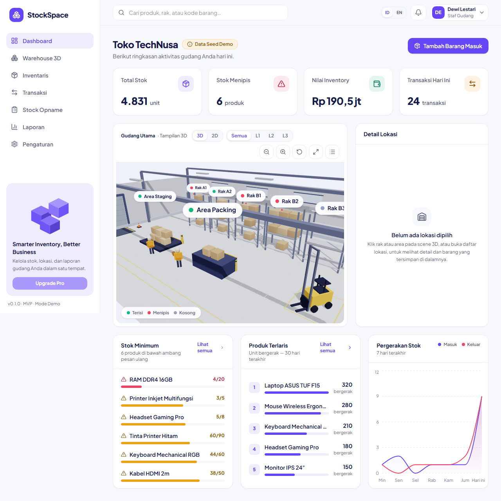
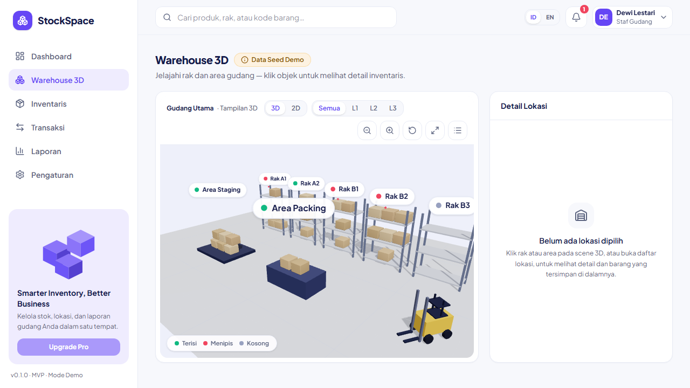
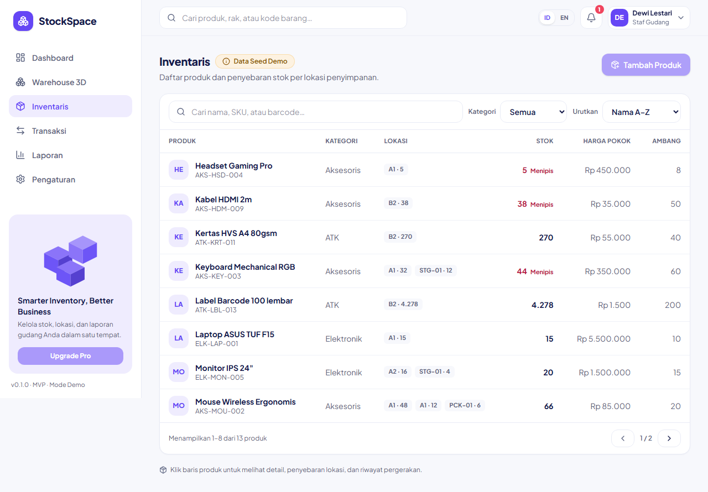
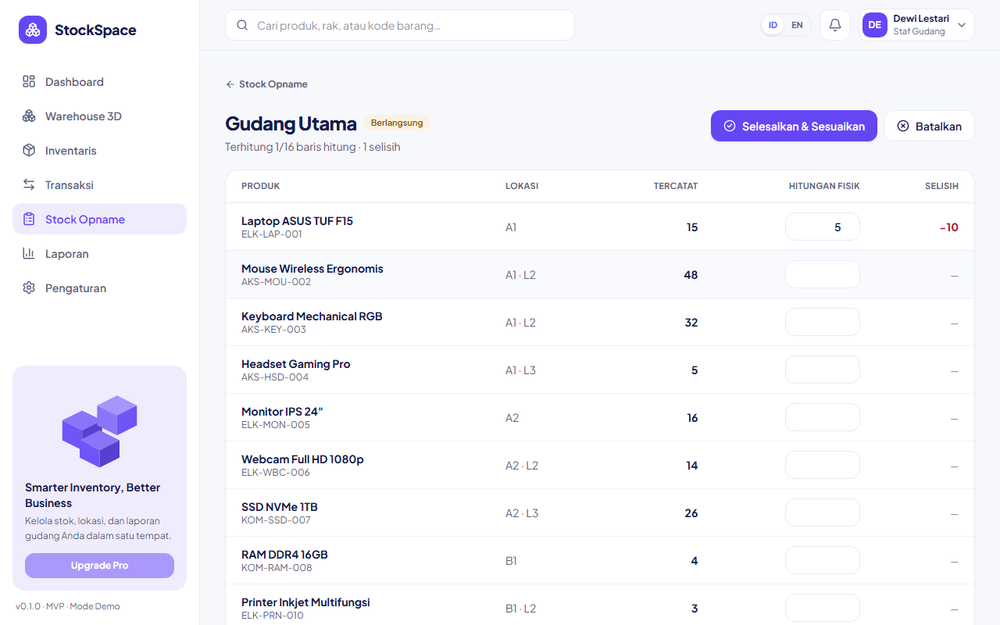
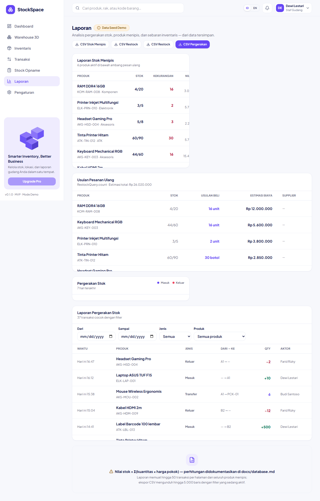
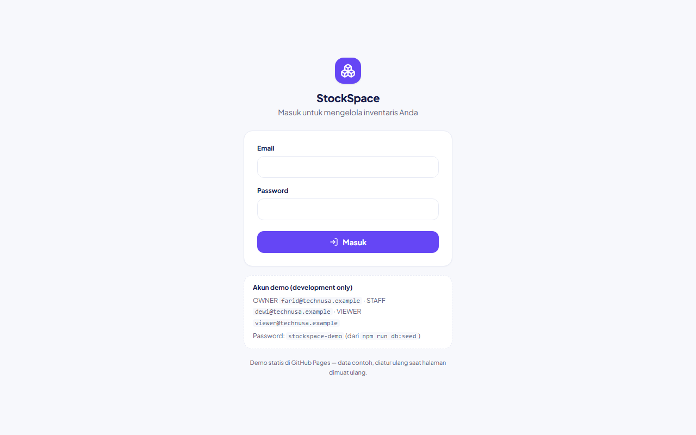

# StockSpace

**Open-source inventory management with an interactive 3D warehouse.**

StockSpace helps small businesses manage inventory while seeing exactly where
products are stored — receive, move, adjust, and issue stock, and explore your
racks in a real 3D scene driven by your saved warehouse layout. Available in
**Bahasa Indonesia and English**.

[](https://github.com/zann06/StockSpace/actions)
[](https://zann06.github.io/StockSpace/)
[License: MIT](LICENSE)

**Try it now — no install:** [interactive live demo](https://zann06.github.io/StockSpace/)
(static build on GitHub Pages: sign in with the demo accounts below, record
movements, watch the 3D delivery animation — sample data, resets on refresh).

## Contents

- [Demo](#demo) · [Screenshots](#screenshots) · [Features](#features)
- [Who it's for](#who-its-for) · [Scope and non-goals](#scope-and-non-goals)
- [Tech stack](#tech-stack) · [Quick start](#quick-start-local-development)
- [Architecture](#architecture) · [Database and consistency](#database-and-consistency)
- [3D warehouse internals](#3d-warehouse-internals)
- [Testing and quality gates](#testing-and-quality-gates)
- [Production deployment (VPS)](#production-deployment-vps)
- [Project structure](#project-structure) · [Roadmap](#roadmap)
- [Contributing](#contributing) · [License](#license)

## Demo

End-to-end flow recorded against the real stack (API + PostgreSQL + browser) —
sign in, browse the 3D warehouse, record a stock-in, watch the forklift carry the
box to its rack, and see the dashboard update:


## Screenshots

| | |
| --- | --- |
|  |  |
|  |  |
|  |  |

*Captured with Playwright against the live demo (Warehouse 3D shows the
fly-to focus on Rak A1 with the other racks dimmed); the UI is built as real
React components following `design-reference.png`.*

## Features

- **Interactive 3D warehouse** — procedural racks, shelves, cargo boxes, and
  staging/packing areas driven by the saved layout. Click a rack to fly the
  camera to it (other racks dim) and open its items and movement history;
  orbit/pan/zoom, camera reset, 3D/2D top-down toggle, level filters (L1–L3),
  fullscreen, and an accessible location list when WebGL is unavailable.
- **Living warehouse** — a procedural shell with walls, high windows, roof
  beams, a dock door, floor markings, pallet freight, bollards, cones, an
  extinguisher, ceiling lights, and four low-poly NPC workers (two perimeter
  walkers and two stationary workers near packing/staging). All geometry is
  original; NPCs follow fixed safe waypoint loops so they never interfere with
  the forklift route planner, and everything freezes under reduced motion.
- **Delivery animation** — a committed stock movement sends the forklift along
  an obstacle-aware route through the aisles (planned against the live
  rack/staging/packing footprints with a safety margin around the loaded
  forklift, so it never cuts through an object), lifts the box through a
  four-stage pickup (approach → align → grip → lift), reverses clear of the
  shelf, carries it with a light suspension bob, and sets it down with a
  landing squash — plus trail particles, a heading indicator, a proximity
  warning ring near racks, and a highlight ring when you click a box. Stock-ins
  also show the inbound crate waiting on the receiving platform until the forks
  collect it. Skipped under reduced-motion.
- **Real inventory workflows** — stock in/out/transfer/adjustment forms write
  to PostgreSQL inside database transactions; overselling is impossible by
  construction and covered by integration tests, including concurrent requests.
- **Dashboard & reports from live data** — KPIs, low-stock summary, top-moved
  products, 7-day movement chart, per-location utilization, filtered movement
  report with pagination, and CSV export.
- **Authentication & roles** — email/password sign-in with cookie sessions
  (better-auth). Roles enforced server-side: VIEWER read-only, STAFF records
  movements, ADMIN+ edits products. Workspaces are membership-scoped.
- **Workspace member management** — Owners/Admins invite existing accounts,
  change roles, and remove members; the last Owner is protected and nobody can
  grant a role above their own.
- **Admin product CRUD** — create and edit products (category, unit, pricing,
  reorder threshold, archive toggle) with an immutable SKU per workspace.
- **Low-stock notifications** — created automatically when a product crosses
  its reorder threshold, grouped (one unread alert per product).
- **Onboarding tour** — an animated spotlight tour introduces the app on first
  sign-in; replay it anytime from Settings.
- **Stock opname (stocktake)** — guided physical count per location/level;
  committing generates adjustment movements automatically inside one
  transaction, with a full audit trail (reference `ST-…`).
- **Restock proposal** — aggregates the reorder shortfall of every active
  product with estimated cost and supplier, exportable as CSV.
- **Product import** — paste or upload a CSV to upsert hundreds of products
  by SKU (per-row error reporting, admin-only).
- **Suppliers** — manage supplier contacts and link them to products and
  stock-in movements; surfaced in the restock proposal.
- **Barcode scan & print** — scan product barcodes with the device camera
  (native BarcodeDetector) to fill the stock-in form, and print Code-128
  labels from the product page.
- **Bilingual (ID/EN)** — switch language from the header or profile menu;
  dates and number formats follow the active locale.
- **Rate limiting, a11y, and E2E** — auth 20/min, movements 60/min, global
  300/min; axe accessibility scan in CI; Playwright smoke test boots the real
  API + web + database.
- **Responsive & accessible** — off-canvas navigation on mobile, keyboard
  support throughout, visible focus states, WCAG-AA text contrast, and
  reduced-motion respected.

Demo data is a fictional seeded workspace ("Toko TechNusa") and every page
labels it with a visible badge.

## Who it's for

Small businesses, independent retailers, and small warehouses that want a
practical inventory tool with a useful — not decorative — 3D view, plus
developers who want to self-host or contribute.

| Role | Can do |
| --- | --- |
| Owner / Admin | Manage products, categories, units, suppliers, locations, users, and settings; view valuation, low-stock alerts, history, and reports |
| Staff / Operator | View inventory and locations; record stock in/out, transfers, adjustments, and stocktakes |
| Viewer | Read-only access to dashboards, products, and the warehouse view |

Permissions are enforced on the server, not only by hiding frontend controls.

## Scope and non-goals

The first release is deliberately an inventory system, not an ERP. Non-goals:
full accounting, invoicing, or payroll; marketplace or shipping-carrier
integrations; AI forecasting or AI-generated purchase orders; robotics,
forklift control, or physical warehouse automation; complex multi-warehouse
enterprise optimization; and a survey-accurate 3D representation of a real
warehouse. The 3D scene is an operational aid and always has a non-3D fallback.

## Tech stack

| Layer    | Choice                                                             |
| -------- | ------------------------------------------------------------------ |
| Frontend | React 19, TypeScript (strict), Vite, React Router, Tailwind CSS v4 |
| 3D       | React Three Fiber, Drei, Three.js (procedural geometry, no models) |
| Charts   | Recharts · Icons: lucide-react (ISC) · Font: Plus Jakarta Sans (OFL) |
| Backend  | Fastify 5 + TypeScript · better-auth (sessions) · Zod validation    |
| Database | PostgreSQL 16 + Prisma 6 (migrations, seed)                         |
| Infra    | Docker Compose, GitHub Actions CI, nginx for static hosting         |

## Quick start (local development)

Requirements: **Node.js ≥ 20.19** (`.nvmrc` pins 22), npm, and Docker (for
PostgreSQL).

```bash
git clone https://github.com/zann06/StockSpace.git
cd stockspace
npm install            # installs all workspaces + generates the Prisma client
cp .env.example .env   # then adjust if needed
npm run db:up          # PostgreSQL on host port 5433 (container 5432)
npm run db:migrate     # apply migrations
npm run db:seed        # fictional demo workspace + development accounts

npm run dev            # web app on http://localhost:5173
npm run dev:api        # REST API on http://localhost:4000
```

**Sign in** at `/login` with the seeded development accounts (fictional
business "Toko TechNusa", password for all: `stockspace-demo`):

| Email | Role | Can do |
| --- | --- | --- |
| `farid@technusa.example` | OWNER | everything, incl. product CRUD |
| `dewi@technusa.example` / `budi@technusa.example` | STAFF | read + record stock movements |
| `viewer@technusa.example` | VIEWER | read-only |

These accounts exist **only in the local development seed** — never in
production (roles are enforced server-side on every request).

In the static demo, sign in as `farid@technusa.example` (OWNER), then open
**Settings → Pengguna** to try member management: invite
`admin@technusa.example` or `sari@technusa.example` (demo accounts that are not
members yet), change their roles, or remove them. Demo state resets on refresh.

### Docker

```bash
docker compose up --build   # web on :8080, API on :4000, PostgreSQL on :5433
```

The API applies migrations on boot (`prisma migrate deploy`). The Pages demo
serves an in-memory sample dataset instead (see `.github/workflows/deploy-pages.yml`).
For production, set a real `BETTER_AUTH_SECRET` — see
[Production deployment (VPS)](#production-deployment-vps).

## Architecture

StockSpace is an npm-workspaces monorepo with a React frontend, a Fastify API,
and PostgreSQL. The 3D scene consumes the same API as every other page.

```text
PostgreSQL 16 ← Prisma → Fastify API (/api/*) → TanStack Query → React pages
                                                                    ↘ React Three Fiber scene
```

- **Monorepo without extra build tooling.** npm workspaces (`apps/*`), Node ≥
  20.19, thin root scripts. The clone-to-run path stays free of Turborepo/Nx;
  the layout can grow into one without moving files.
- **Frontend.** React 19 + TypeScript strict + Vite + React Router + Tailwind
  v4. UI primitives are small hand-written accessible components rather than a
  wholesale component-library dependency. The font is self-hosted
  (`@fontsource-variable/plus-jakarta-sans`, OFL).
- **Data flow.** TanStack Query fetches workspace, layout, products, movements,
  dashboard summary, and notifications from the API. Mutations invalidate the
  affected query keys, so balances, history, dashboard metrics, and the 3D
  scene refresh together. The fictional dataset in `apps/web/src/mocks/` feeds
  the static Pages demo (`api/demo-api.ts`) and the test fetch stub; the real
  API path never imports it.
- **API and database.** Fastify (ESM, `NodeNext`) with Zod validation on every
  external input; PostgreSQL 16 + Prisma. Stock changes run in Prisma
  interactive transactions; decrements use conditional
  `UPDATE … WHERE quantity >= n`, which serializes concurrent writers and makes
  overselling impossible. Movements are append-only.
- **Auth and roles.** better-auth with email/password credentials, scrypt
  hashing, and HTTP-only cookie sessions. Every data route resolves the
  session, the active workspace (`X-Workspace-Id`, with membership check), and
  the required role: VIEWER read-only · STAFF records movements · ADMIN+ edits
  products · OWNER manages the workspace. The movement actor is always the
  session user.
- **Bilingual UI and onboarding.** A zero-dependency gettext-style catalog
  (`apps/web/src/i18n`) uses Indonesian source strings as keys with graceful
  English fallback; the active locale also drives `Intl` number/date formats.
  The spotlight tour anchors to real UI elements via `data-tour` attributes and
  can be replayed from Settings.
- **Quality gates.** ESLint + Prettier + strict `tsc` + Vitest in CI: a web
  job (unit/component tests with an API fetch stub), an API job running
  integration tests against a real PostgreSQL service container, and a
  Playwright job (smoke + axe accessibility scan). `main` stays green.
- **Client configuration.** `apps/web/src/lib/env.ts` validates
  `import.meta.env` with Zod at startup, so a misconfigured build fails loudly
  instead of rendering a half-configured app.

## Database and consistency

PostgreSQL 16 + Prisma. The schema lives in `prisma/schema.prisma`, migrations
in `prisma/migrations/`, and the fictional seed in `prisma/seed.ts`.

```text
Workspace 1─n WorkspaceMember n─1 User
Workspace 1─n Warehouse 1─n Zone 1─n StorageLocation
Workspace 1─n Category 1─n Product
Product 1─n InventoryBalance n─1 StorageLocation   ← current stock per location + level
Workspace 1─n StockMovement (append-only)          ← every committed stock change
Workspace 1─n Notification
```

Key choices:

- **UUID primary keys** for non-guessable identifiers.
- **`costPrice` is `Decimal(14,2)`** — money is never a float.
- **`InventoryBalance.quantity` is `Int` with `CHECK (quantity >= 0)`**.
  Conditional API updates are the primary enforcement; the constraint is the
  last line of defense.
- **`StockMovement` is append-only.** Corrections are compensating
  `ADJUSTMENT` movements; nothing edits or deletes history.
- Uniqueness is scoped per workspace: `Product(workspaceId, sku)`,
  `StorageLocation(warehouseId, code)`, `Category(workspaceId, name)`.
- Layout coordinates (`x`, `z`, `rotation`, `levels`, `capacity`) are stored on
  `StorageLocation`; the 3D scene renders exclusively from these rows.

**How stock stays consistent.** All four movement types run inside one Prisma
interactive transaction: re-validate location/product → conditional decrement
(`updateMany` with `quantity >= n`) → atomic upsert/increment of the
destination → insert the movement record. A failure at any step rolls back the
balance change. The integration suite fires parallel stock-outs against a
small balance and asserts that exactly the available units are consumed;
overselling returns `422 INSUFFICIENT_STOCK` and writes nothing.

**Inventory value** is cost-price valuation:
`Σ over balances (quantity × product.costPrice)`, computed from persisted rows
in `GET /api/dashboard/summary`.

**Backups.** Schedule `pg_dump` via cron, copy the archive off-box
(rclone/S3), and test restores regularly — a backup that lives only on the
server is not a backup.

## 3D warehouse internals

```text
StorageLocation rows (x, z, rotation, type, capacity)
  → GET /api/warehouses/:id/layout
    → TanStack Query (cached, invalidated with movements)
      → WarehouseScene (React Three Fiber)
```

- **Procedural geometry only.** Racks (uprights + shelf boards), cargo boxes,
  staging/packing platforms, and the warehouse shell (walls, high windows, roof
  beams, dock door, floor markings, pallets, bollards, cones, extinguisher,
  ceiling lights) are generated in code. There are **no external 3D assets** to
  license.
- **Living scene.** Four low-poly NPCs — two perimeter walkers on fixed
  waypoint loops and two stationary workers near packing/staging — animate with
  eased turns, a natural walk cadence, and grounded blob shadows. Fixed loops
  replace dynamic pathfinding, so NPCs never force the forklift to replan.
  Under reduced motion they hold a static pose.
- **Deterministic cargo.** Boxes per shelf row follow the balance quantity
  (`≥ 200 → 3`, `≥ 40 → 2`, else 1), so the scene is stable across reloads.
- **Status colours.** Terisi (green) · Menipis (red, any product below its
  reorder threshold) · Kosong (grey). Colour is never the only signal: the
  same status appears in the location list, tooltips, and detail panel.
- **Focus mode.** Selecting a location glides the camera to a computed view of
  it; other racks render translucent so the selected one stays legible.

### Delivery animation

A saved movement emits a `MovementEvent`; the scene queues it and drives one
forklift trip at a time. Routes are planned against the **live layout**: rack,
staging, and packing footprints are inflated by the forklift body clearance, an
A* pass finds a collision-free path across the floor, line-of-sight
simplification removes grid stair-steps, and quadratic fillets round every
corner. The planner tightens the fillet radius until the arc still respects a
`0.52` safety clearance, so the loaded forklift never cuts through an object
even when locations move in the database.

| Phase | Motion |
| --- | --- |
| Drive to source | Obstacle-aware route to a pre-dock point, then a short straight lead-in aligned with the shelf/platform. A calm ease-in-out covers the 1.3–6.5 s travel window. |
| Lift | Cubic-bezier fork rise (0.62 s) with a four-stage box micro-animation — approach → align → grip → lift (`multiPhasePickup`) |
| Reverse out | The loaded forks back straight out of the rack for 0.7–0.9 units before the machine pivots, so the box never sweeps through the uprights |
| Carry | Planned route to the destination pre-dock, with velocity-based easing (accelerate, cruise, brake), smooth steering, and a small speed-scaled suspension bob |
| Place | Box slides off the tines, gravity drop with squash-and-stretch and a landing flash, then the glow fades |
| Reverse + return | Backs clear of the destination, pivots in the open aisle, then takes a planned route back to the parking spot |

**Inbound crate:** a stock-in from the receiving area shows a kraft crate
waiting on the staging platform before the forklift arrives. It is the box the
machine collects; it disappears under the forks as the lift begins.

Feedback layered on top: trail particles from an object pool, a heading
indicator cone, an amber→red proximity ring when a rack is within 1.5 units
while moving, and a pulsing ring on the pickup location. Everything except rack
selection is skipped when the user prefers reduced motion — the movement is
still recorded, just not animated.

### Fallbacks and performance

- **No WebGL** (`isWebGLAvailable()` probe or render-time failure via
  `SceneErrorBoundary`) → the accessible location list replaces the canvas;
  every feature stays reachable.
- `dpr` capped at 2, one shadow-casting light, a single 1024² shadow map, and
  ~40 low-poly meshes — comfortable on integrated graphics.
- Distant cargo boxes drop out of the shadow pass (LOD) but stay visible, so
  zooming out never makes a stocked rack look empty. Trail particles come from
  a fixed-size pool and are gated behind reduced-motion.
- Movements invalidate the layout query, so balances and status dots update
  without a manual refresh.
- Shadows use the percentage-closer filter (`PCFShadowMap`) explicitly:
  three.js removed `PCFSoftShadowMap`, which react-three-fiber still mapped the
  plain `shadows` prop to. One console warning remains and is owned by the
  library: react-three-fiber instantiates `THREE.Clock`, which three.js has
  deprecated in favour of `THREE.Timer`; it is harmless and disappears once
  the renderer updates upstream.

## Testing and quality gates

```bash
npm run lint         # ESLint (web + api)
npm run typecheck    # tsc (strict)
npm run test         # Vitest — web unit/component + API integration (real PostgreSQL)
npm run build        # production build (web + api)
npm run format:check # Prettier
npm run test:e2e -w apps/web   # Playwright smoke + axe a11y scan
                              # (boots API + web automatically, seeds stockspace_e2e)
```

CI runs the same gates in three jobs — `web`, `api` (PostgreSQL service
container), and `e2e` (PostgreSQL + chromium).

## Production deployment (VPS)

Deploy the full stack (PostgreSQL, Fastify API, nginx-served web app) on an
Ubuntu 22.04/24.04 VPS with Docker Compose over SSH. Estimated time: 20–30
minutes.

1. **Harden the server.** Allow only SSH/HTTP/HTTPS (`ufw`), disable password
   login, and keep key-only SSH.
2. **Install Docker** (`curl -fsSL https://get.docker.com | sudo sh`) and clone
   the repository to `/opt/stockspace`.
3. **Configure `.env`** with real secrets:

   ```env
   DATABASE_URL=postgresql://stockspace:<strong-db-password>@db:5432/stockspace
   BETTER_AUTH_SECRET=<openssl rand -base64 32>
   BETTER_AUTH_URL=https://inventory.example.com
   CORS_ORIGIN=https://inventory.example.com
   ```

   Change the default PostgreSQL password in both `.env` and
   `docker-compose.yml` (or an override file). Put Caddy/nginx in front for
   TLS; `BETTER_AUTH_URL` and `CORS_ORIGIN` must match the public origin
   because session cookies are bound to it.

4. **Start the stack:** `docker compose up -d --build`. The API runs
   `prisma migrate deploy` before boot; verify `http://localhost:8080` and
   `docker compose ps`.
5. **Close exposed ports.** The compose file publishes `5433` and `4000`; block
   them at the firewall or remove the mappings so only the reverse proxy is
   public.
6. **Back up and update.** Schedule a nightly `pg_dump`, copy archives off-box,
   and update with `git pull && docker compose up -d --build`.

| Symptom | Fix |
| --- | --- |
| `api` restarts with `P1000` | DB password mismatch between `.env` and compose; reset the user password or recreate the volume |
| Login loop / 401 after sign-in | `BETTER_AUTH_URL` / `CORS_ORIGIN` do not match the public origin (scheme + host) |
| 3D scene empty | `GET /api/warehouses` is empty → the workspace has no warehouse; seed or create one |
| Migration failed mid-boot | Check `docker compose logs api`, fix, then `docker compose up -d api` (migrate deploy is idempotent) |

## Project structure

```text
stockspace/
├── apps/web/          # React frontend (3D warehouse, dashboards, forms, e2e specs)
├── apps/api/          # Fastify REST API (auth, movements, reports)
├── prisma/            # Schema, migrations, fictional seed
├── docs/screenshots/  # README media only
├── .github/           # CI, issue/PR templates, CONTRIBUTING, SECURITY, CODE_OF_CONDUCT
├── docker/            # PostgreSQL init scripts
├── docker-compose.yml
└── README.md          # product, architecture, database, 3D, deployment docs
```

The README is the single source of truth for product and technical
documentation. Community health files live in `.github/` so the repository root
stays focused.

## Roadmap

- [x] Phase 0 — monorepo, tooling, Docker, CI
- [x] Phase 1 — UI shell + 3D prototype
- [x] Phase 2 — Fastify API + PostgreSQL/Prisma, transactional movements
- [x] Phase 3 — web wired to live data
- [x] Phase 4 — better-auth, server-side roles, reports + CSV, notifications
- [x] Phase 5 — a11y pass, E2E smoke + axe, rate limiting, VPS guide
- [x] Post-MVP polish — bilingual ID/EN, onboarding tour, delivery animation
- [x] Post-MVP features — stock opname, restock proposal, product import,
      suppliers, barcode scan & print
- [x] Post-MVP animation pass — eased forklift choreography, box interaction
      feedback, proximity alerts, LOD + reduced-motion coverage
- [x] Post-MVP 3D pass — living warehouse set dressing, NPC workers, fly-to focus
- [x] Post-MVP features — workspace member management, admin product CRUD

**Ideas beyond the MVP:** pending email invitations (needs a mail provider and
an invite model), multi-warehouse layouts, and smarter 3D navigation (location
search, occupancy heatmap, route preview).

## Contributing

Contributions are welcome. Read [`.github/CONTRIBUTING.md`](.github/CONTRIBUTING.md)
for setup, branch/commit conventions, code style, and the pull-request
checklist.

- UI strings go through the i18n catalog (`apps/web/src/i18n`) — add the
  English entry when introducing new copy.
- Keep 3D geometry procedural/original, respect reduced motion, and preserve
  the WebGL fallback.
- Security reports follow [`.github/SECURITY.md`](.github/SECURITY.md) — use
  GitHub's private vulnerability reporting, not a public issue.
- By participating you agree to the
  [Code of Conduct](.github/CODE_OF_CONDUCT.md).

## License

[MIT](LICENSE) © StockSpace contributors. Third-party assets and tools:

| Component | License | Notes |
| --- | --- | --- |
| [lucide](https://lucide.dev) icons | ISC | bundled in the app |
| _Plus Jakarta Sans_ font (Fontsource) | SIL OFL 1.1 | bundled; OFL permits redistribution with attribution |
| ffmpeg-static | GPL-3.0-or-later | **dev-only tool** used to render the demo GIF — never shipped in the application or its builds |
| @axe-core/playwright | MPL-2.0 | dev-only (accessibility scans in tests) |

All 3D geometry is procedural/original, and `design-reference.png` ships with
this repository as the project brief's visual reference.
